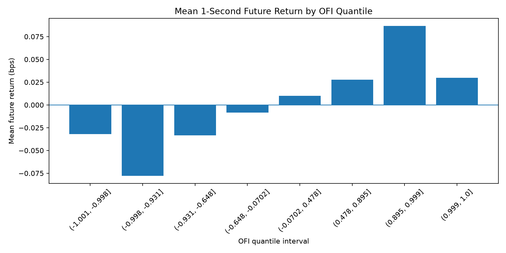
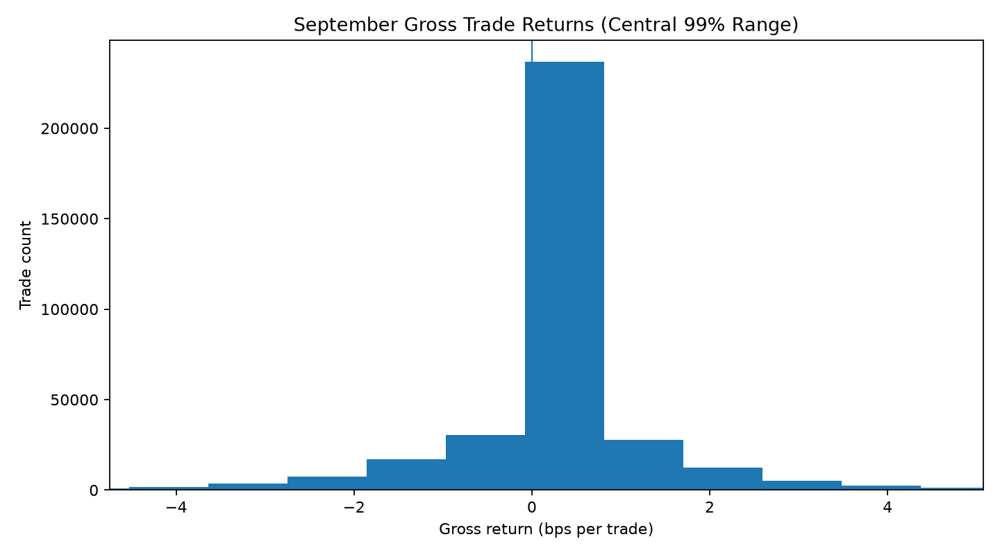

# BTCUSDT Order-Flow Imbalance Research

A quantitative research study investigating whether aggressive buy/sell
volume imbalance predicts short-horizon BTCUSDT returns, and whether the
observed gross edge survives transaction costs.

## Summary

- **Question:** Does aggressive trade-volume imbalance predict short-horizon BTCUSDT returns?
- **Data:** Binance BTCUSDT spot aggregate trades, aggregated into one-second bars.
- **Feature:** Normalized aggressor-signed trade-volume imbalance.
- **Rule:** Thresholds of +0.75/-0.75; five-second decision grid, one-second entry delay, five-second holding period.
- **Holdout:** September 2026, evaluated using the frozen baseline `v1.0-frozen-ofi`.
- **Result:** +0.096789 bps mean gross return per trade; insufficient to cover the assessed trading costs.

## Research question

Does normalized order-flow imbalance contain predictive information
about BTCUSDT returns over 1-30 seconds? If so, is the relationship
large enough to support a simple directional trading strategy after
transaction costs?

## Main findings

The frozen threshold strategy produced a small positive mean gross
return in the September 2026 historical holdout. However, the estimated
edge was substantially smaller than the assessed trading costs.

|Metric|September 2026|
|-|-:|
|One-second observations|2,592,000|
|Simulated trades|348,931|
|Mean gross return per trade|+0.09679 bps|
|Median gross return per trade|0.00000 bps|
|Gross win rate|39.08%|
|Days with positive mean gross return|30 / 30|
|Break-even round-trip cost|0.09679 bps|

A block bootstrap of daily mean returns produced positive descriptive
95% intervals across the tested block lengths. This supports a positive
average gross return within this sample, but does not establish future
persistence or executable profitability.

A hypothetical round-trip cost of 1 bp reduces the mean return to
-0.90321 bps per trade. The assessed Spot fee scenarios also exceed the
measured gross edge, before spread, slippage and execution uncertainty.

**Conclusion:** The tested strategy is not economically viable under
the assessed transaction costs. The study does not establish an
executable trading edge.

See [the full research report](reports/final_report.md) for the
methodology, detailed results, uncertainty analysis, fee assumptions
and limitations.

## Frozen strategy specification

The baseline is documented in
[reports/frozen\_strategy.md](reports/frozen_strategy.md) and tagged
in Git as `v1.0-frozen-ofi`.

* Long when flow imbalance >= 0.75.
* Short when flow imbalance <= -0.75.
* Decision grid: every 5 seconds.
* Entry-price proxy: t+1 second.
* Exit-price proxy: t+6 seconds.
* Holding period: 5 seconds after entry.
* No minimum-trade-count filter.

September was evaluated without tuning the strategy to its results.
It is a retrospective historical holdout, not a live forward test.

## Methodology

1. Download Binance BTCUSDT spot aggregate-trade archives.
2. Sign each trade's quantity using the aggressor side.
3. Aggregate trades into one-second bars and calculate normalized
signed-volume imbalance.
4. Calculate forward last-trade-price returns.
5. Explore conditional returns, correlations and regression controls.
6. Evaluate a fixed directional threshold strategy.
7. Assess timing, placebo results, return distributions and transaction
cost sensitivity.
8. Evaluate the frozen baseline on the September 2026 historical period.

## Selected figures

### Conditional returns by OFI bucket



The conditional means generally become more positive as OFI increases, but the relationship is not monotonic at the extremes. All eight bucket medians are zero.

### September holdout return distribution



The median return is zero and 28.46% of trades have exactly zero returns. The positive mean is affected by the tails, and the simulated returns exclude executable trading costs.

## Limitations

* Uses last-trade-price proxies rather than executable historical
bid/ask quotes.
* Carries the last known price forward across seconds without trades,
producing zero returns in inactive periods at short horizons.
* Does not model spread, slippage, market impact, queue position,
latency or actual order-fill uncertainty.
* Simulated short trades require an appropriate venue or product and
separate fee and execution assumptions.
* Positive gross returns and statistical significance do not establish
net profitability.
* September is one historical month; results may not generalize to
other periods or market regimes.
* Fee-free compounded returns are not presented as investable
performance claims.

## Project structure

```text
btc-flow-study/
├── data/
│   ├── raw/                 # Downloaded archives; not committed
│   └── processed/           # Generated datasets; not committed
├── src/                     # Data, diagnostics and backtest scripts
├── tests/                   # Automated tests
├── reports/
│   ├── final\_report.md
│   ├── experiment\_log.md
│   ├── frozen\_strategy.md
│   └── figures/
├── requirements.txt
├── run_research.ps1
├── requirements-dev.txt
└── README.md
```

Generated data and CSV outputs remain local rather than being committed
to Git. Research reports and figures are version-controlled.

## Reproducing the research

Create and activate a virtual environment, then install the dependencies:

```powershell
python -m venv .venv
.\.venv\Scripts\Activate.ps1
python -m pip install -r requirements-dev.txt
```

Run the complete pipeline for the September 2026 evaluation:

```powershell
.\run_research.ps1
```

To evaluate a different date range, pass the start and end dates explicitly. For example:

```powershell
.\run_research.ps1 -StartDate "2025-06-01" -EndDate "2025-06-07"
```

The runner downloads the required Binance archives, builds the one-second dataset and forward-return targets, runs the backtest and evaluation, and executes the automated tests. Generated datasets and result files are written locally and are excluded from Git.

Ten automated tests cover backtest mechanics, aggressor-side signing, imbalance normalisation, forward-fill behaviour and target alignment.

September 2026 is the historical holdout reported in this study. Results from other date ranges are additional evaluations, not replacements for the frozen strategy specification.

## Responsible interpretation

This repository is an empirical research exercise, not a trading
recommendation. Its primary contribution is the research process:
forming a hypothesis, testing a fixed rule, evaluating uncertainty,
accounting for transaction costs and documenting a negative economic
conclusion.
